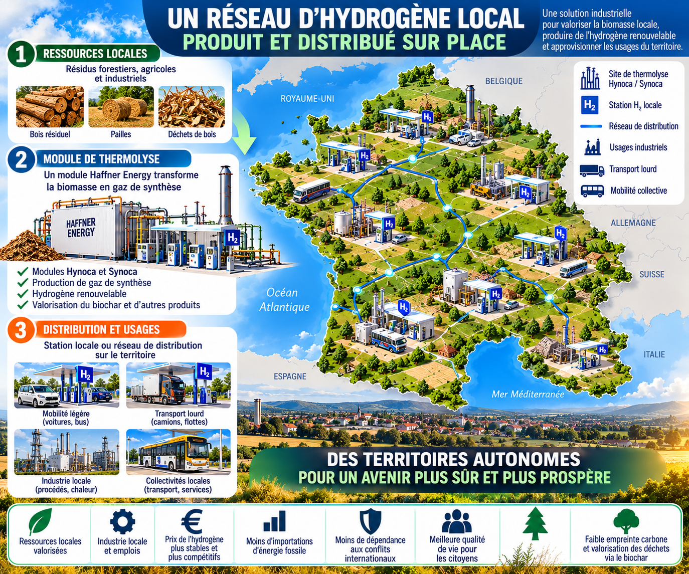
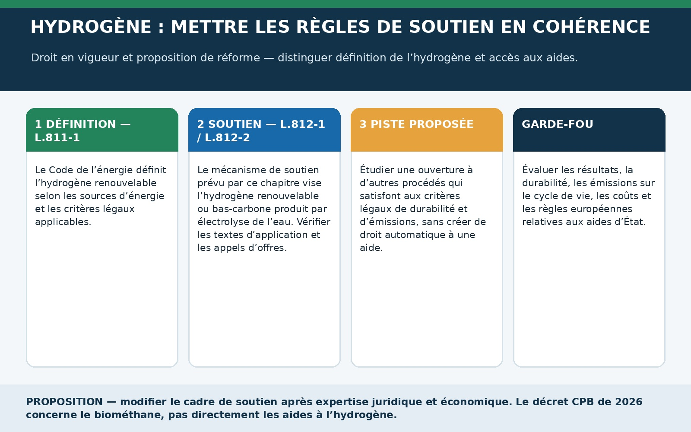
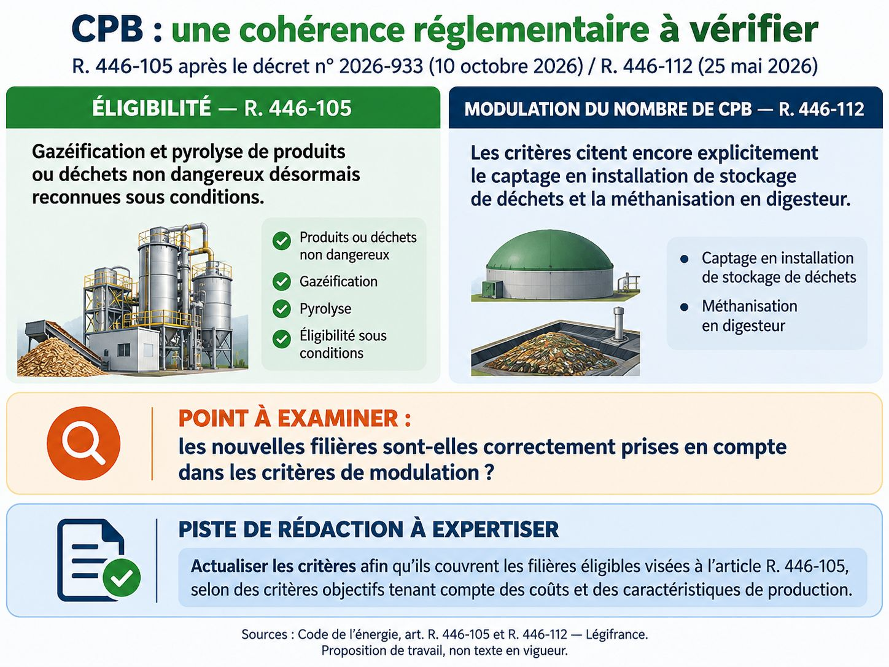
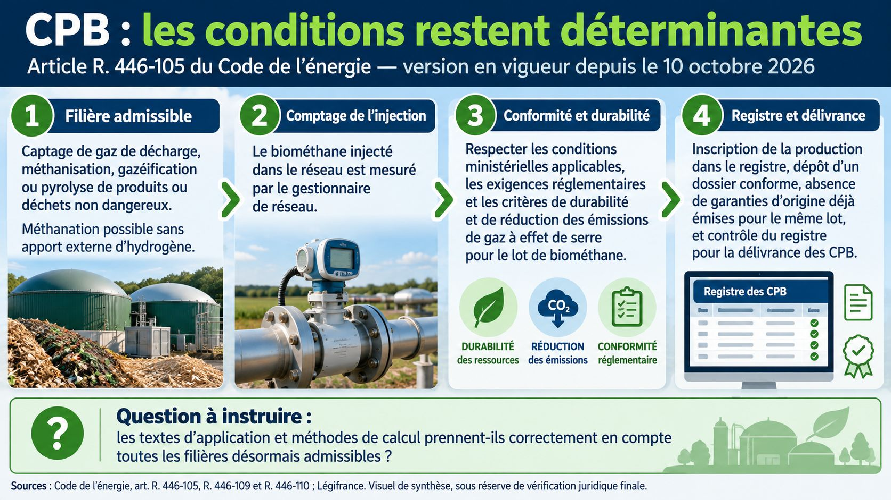
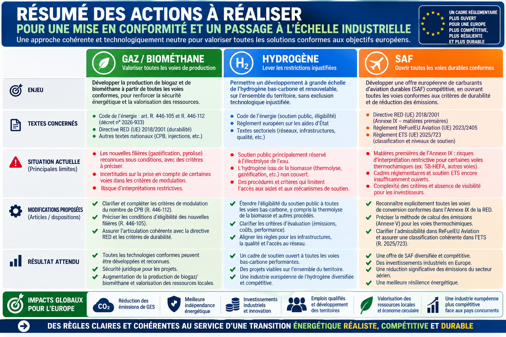

# Souveraineté énergétique : remettre les règles en cohérence pour libérer les solutions

*Éric Jacob — Dossier de travail, version française — 20 octobre 2026*

> L’Europe ne manque pas seulement de technologies. Elle a aussi besoin de règles qui leur permettent de démontrer ce qu’elles savent faire.

La transition énergétique est souvent racontée comme une course aux investissements : annoncer des capacités, ouvrir des guichets, mobiliser des milliards, fixer des objectifs toujours plus ambitieux. Tout cela peut être nécessaire. Mais une question plus discrète précède les autres : les règles que nous avons écrites permettent-elles réellement aux solutions capables de contribuer à ces objectifs d’exister, de se développer et de changer d’échelle ?

Une technologie peut être prometteuse sans être automatiquement éligible à un mécanisme de soutien, à une catégorie réglementaire ou à une méthode de certification. À l’inverse, l’existence d’une aide ne garantit ni la compétitivité durable, ni la disponibilité des matières premières, ni l’existence de clients. Quand la réglementation privilégie une voie sans comparer les résultats, puis que l’on ajoute des aides pour compenser les difficultés de la filière retenue, le risque est de financer les symptômes sans examiner la cause.

Ce dossier part d’une idée simple : **les objectifs doivent être exigeants, les critères transparents et les voies technologiques ouvertes lorsqu’elles peuvent satisfaire ces mêmes critères**. La neutralité technologique ne signifie pas que toutes les solutions se valent. Elle signifie que les différences de traitement doivent reposer sur des raisons explicites et vérifiables : émissions sur le cycle de vie, durabilité des intrants, efficacité, coût complet, disponibilité des ressources, sécurité et débouchés.

Trois domaines permettent d’examiner cette question sous des angles complémentaires : l’hydrogène renouvelable, les carburants d’aviation durables (SAF) et le biométhane. Ils ne relèvent pas des mêmes textes ni des mêmes marchés. Il serait donc erroné de leur appliquer mécaniquement un régime unique. Mais ils révèlent une même nécessité : éviter que les objectifs affichés, les définitions légales, les textes d’application et les dispositifs économiques ne finissent par se contredire ou par laisser des angles morts.

## 1. Le problème de fond : une politique publique ne se résume pas à ses subventions

L’argent public peut aider une filière à franchir un cap : financer la recherche, réduire le risque d’une première installation industrielle, construire des infrastructures partagées ou corriger une externalité que le marché ne prend pas en compte. Il ne peut toutefois pas remplacer indéfiniment un modèle économique viable, ni réparer à lui seul une architecture réglementaire mal ajustée.

Quand une technologie ne peut pas entrer dans une catégorie d’éligibilité, faire reconnaître ses performances ou utiliser une méthode adaptée pour calculer ses émissions, le débat se déplace trop facilement vers le montant des aides. Or la première question devrait être juridique et méthodologique : **le cadre permet-il de comparer les solutions selon les objectifs que la politique publique prétend poursuivre ?**

| Situation | Ce qu’on peut conclure | Ce qu’il faut faire |
|---|---|---|
| Une loi réserve expressément un dispositif à une technologie. | Il existe une restriction dans ce dispositif précis, pas nécessairement une interdiction générale. | Examiner la justification et l’éventuelle ouverture sous critères communs. |
| La loi reconnaît une voie, mais un texte d’application paraît plus étroit. | Un problème d’articulation ou de mise en œuvre est possible. | Comparer les textes, leur hiérarchie et leur application réelle. |
| Deux dispositions utilisent des formulations différentes. | La différence mérite examen, mais ne prouve pas à elle seule une exclusion. | Vérifier le contexte, les renvois et les pratiques administratives. |
| Une voie est éligible mais demeure coûteuse ou limitée par les ressources. | Le problème n’est pas nécessairement réglementaire. | Examiner coûts, rendements, intrants, infrastructures et débouchés. |

Le travail proposé ici n’est donc pas de réclamer un droit automatique à la subvention. Il vise à permettre à chaque solution de démontrer sa valeur dans un cadre lisible, contrôlable et cohérent. Une technologie qui ne respecte pas les critères climatiques ou de durabilité doit échouer à l’évaluation. Une technologie qui les respecte ne devrait pas être écartée simplement parce qu’elle suit une voie différente, sauf justification explicite.

## 2. Hydrogène renouvelable : quand la définition et le mécanisme de soutien ne couvrent pas le même périmètre

L’hydrogène n’est pas une fin en soi. Son intérêt dépend de l’usage, de la ressource mobilisée, de l’énergie consommée, des émissions sur l’ensemble du cycle de vie et de la possibilité de le produire au bon endroit et au bon coût. L’électrolyse peut être pertinente lorsque l’électricité renouvelable est disponible dans des conditions adaptées. D’autres voies thermochimiques, notamment à partir de biomasse durable, méritent également une évaluation rigoureuse lorsque les conditions légales sont satisfaites.

Le Code de l’énergie distingue la définition de l’hydrogène renouvelable et les mécanismes de soutien à sa production. L’article L. 811-1 ne réduit pas sa formulation à la seule électrolyse. En revanche, les articles L. 812-1 et L. 812-2, dans le dispositif qu’ils organisent, ciblent l’hydrogène renouvelable ou bas-carbone produit par électrolyse de l’eau. La conséquence doit être formulée avec précision : il s’agit d’une limitation du périmètre de ce mécanisme particulier, et non d’une interdiction générale de produire de l’hydrogène par d’autres voies, ni de la preuve que toute aide publique est inaccessible.

### Ce qu’il faut vérifier

Le diagnostic doit descendre de la loi vers les règles qui déterminent effectivement l’accès au dispositif : décret, dispositions réglementaires, critères d’éligibilité, méthodes de calcul, appels à projets, cahiers des charges et contrats. Les articles R. 812-2, R. 812-14, R. 812-18, R. 812-19 et R. 812-26 ainsi que le décret n° 2023-854 du 1er septembre 2023 font partie des textes à examiner dans leur version applicable. Il faut vérifier le rôle exact de chaque disposition avant de lui attribuer une exclusion qu’elle n’énoncerait pas expressément.

La proposition n’est pas de remplacer un monopole technologique par un autre. Elle consiste à demander si le dispositif de soutien peut apprécier plusieurs voies de production à l’aide de critères communs, tout en conservant les exigences de durabilité, de traçabilité et de réduction des émissions. La biomasse ne doit pas être réputée durable par principe : son origine, ses usages concurrents, son bilan de cycle de vie et le respect des règles européennes doivent être établis.

| Question | Diagnostic | Piste de travail |
|---|---|---|
| La définition légale et le périmètre du soutien sont-ils identiques ? | Non : L. 811-1 et L. 812-1/L. 812-2 doivent être lus séparément. | Évaluer une harmonisation explicite, sans droit automatique à l’aide. |
| Tous les textes réglementaires excluent-ils les procédés non électrolytiques ? | Cela doit être établi article par article. | Auditer textes, appels à projets et cahiers des charges effectivement applicables. |
| Une voie thermochimique est-elle automatiquement éligible au droit européen ? | Non. Durabilité, émissions, définition du produit et aides d’État peuvent intervenir. | Constituer une démonstration documentée et obtenir les validations nécessaires. |

### Proposition de réforme à expertiser

Réexaminer les articles L. 812-1 et L. 812-2 afin de déterminer s’ils peuvent viser les différentes voies de production d’hydrogène renouvelable ou bas-carbone répondant aux exigences légales, plutôt que de réserver le dispositif à une seule technologie par principe. Toute modification devrait préserver les seuils d’émissions, les garanties de durabilité, la traçabilité et le contrôle des performances. Les textes réglementaires et les cahiers des charges ne devraient ensuite être adaptés que là où l’audit montre une restriction ou une incohérence réelle.

Cette réforme ne signifie ni que la thermolyse est automatiquement admissible à un financement, ni qu’elle sera plus compétitive dans tous les territoires. Elle signifie que la décision doit résulter d’une évaluation comparable, et non d’une impossibilité de concourir liée à la seule voie technologique.

**Sources officielles**

- [Code de l’énergie — article L. 811-1](https://www.legifrance.gouv.fr/codes/article_lc/LEGIARTI000049463903/2026-02-22)
- [Code de l’énergie — article L. 812-1](https://www.legifrance.gouv.fr/codes/article_lc/LEGIARTI000043154077/2026-07-13)
- [Code de l’énergie — article L. 812-2](https://www.legifrance.gouv.fr/codes/article_lc/LEGIARTI000043154079/2026-10-09)
- [Code de l’énergie — dispositions réglementaires du chapitre](https://www.legifrance.gouv.fr/codes/id/LEGISCTA000048040122)
- [Décret n° 2023-854 du 1er septembre 2023](https://www.legifrance.gouv.fr/jorf/id/JORFTEXT000048039013)
- [Publication LinkedIn : Hydrogène, passage à l’échelle et décentralisation](https://fr.linkedin.com/posts/eric-jacob-299a21344_hydrog%C3%A8ne-haffnerenergy-thermolyse-activity-7516468302353895424-4Ypq)

## 3. SAF : les objectifs européens doivent laisser une place aux voies durables qui peuvent les atteindre

L’aviation ne peut pas remplacer du jour au lendemain ses carburants liquides par de l’électricité. Les carburants d’aviation durables sont donc appelés à jouer un rôle important, mais le terme SAF recouvre plusieurs voies de production, matières premières et exigences de certification. Une huile intermédiaire issue de biomasse n’est pas automatiquement un carburant d’aviation durable admissible : il faut vérifier la voie de conversion, les caractéristiques du carburant final, la certification, les critères de durabilité et le bilan d’émissions.

La voie SB-HEFA présentée par Haffner Energy repose sur la thermolyse de biomasse solide résiduelle pour produire une phase liquide destinée à être valorisée en carburants. Son intérêt potentiel tient notamment à la possibilité de mobiliser des résidus solides plutôt que de dépendre exclusivement de certaines huiles ou graisses. Cela ne dispense pas de démontrer la qualité du produit, la disponibilité réelle des intrants, la performance environnementale et la conformité de la voie au cadre européen. Le procédé, le produit intermédiaire et le carburant final doivent être distingués avec soin.

### Trois ensembles de règles, trois questions différentes

La directive sur les énergies renouvelables (RED) définit notamment les catégories de matières premières, les critères de durabilité, les réductions d’émissions et les règles de certification. Le règlement ReFuelEU Aviation organise les obligations relatives aux SAF et renvoie aux critères applicables du droit européen. Enfin, le système d’échange de quotas d’émission (ETS) et le règlement délégué (UE) 2025/723 organisent des mécanismes spécifiques de soutien à certains carburants admissibles.

Ces textes ne poursuivent pas exactement le même objectif. Il serait donc imprudent de conclure qu’une voie est exclue du SAF ou de tout soutien sur la seule base d’une différence entre catégories. Il faut déterminer dans quelle catégorie la matière première entre, quelle voie de conversion est reconnue, quelles conditions de certification s’appliquent et quel niveau de soutien est attaché au carburant effectivement admissible.

| Texte | Fonction | Vérification nécessaire pour SB-HEFA |
|---|---|---|
| Directive (UE) 2018/2001 (RED), notamment annexes IX et V et article 30 | Matières premières, durabilité, calcul des émissions et certification. | Vérifier la catégorie exacte des intrants, la méthode applicable et les preuves requises. |
| Règlement (UE) 2023/2405, ReFuelEU Aviation | Obligations et définition des carburants admissibles. | Confirmer que la voie et le carburant final satisfont aux conditions réglementaires et techniques. |
| Directive 2003/87/CE et règlement délégué (UE) 2025/723 | Soutien lié au système ETS pour certaines catégories admissibles. | Déterminer la catégorie applicable ; ne pas supposer que SB-HEFA est exclu ni qu’il bénéficie automatiquement du taux le plus favorable. |
| Certification et normes techniques du carburant | Qualité, traçabilité et utilisation en aviation. | Confirmer la qualification et la conformité du carburant final. |

### Le point de vigilance : neutralité technologique ne signifie pas absence de critères

La biomasse est une ressource limitée, disputée entre chaleur, matériaux, gaz, hydrogène, carburants liquides et maintien des fonctions écologiques des sols et des forêts. Une politique cohérente doit éviter de compter plusieurs fois la même ressource, tenir compte des usages alternatifs et favoriser les voies qui obtiennent les meilleurs résultats dans un contexte donné.

Mais ces exigences ne justifient pas de fermer une voie avant d’avoir établi comment elle doit être évaluée. Si une catégorie de matière première ou de conversion est mal définie, si une méthode ne reflète pas correctement un bilan vérifiable ou si un dispositif classe les carburants sans examiner une voie émergente, la réponse doit être une clarification documentée, pas une présomption d’éligibilité ni une exclusion automatique.

### Proposition de travail

Lancer une revue conjointe RED–ReFuelEU–ETS centrée sur les voies SAF issues de biomasse solide résiduelle. Cette revue devrait publier une matrice de correspondance entre intrants, procédés, carburants finaux, critères de durabilité, méthodes de calcul, certifications et mécanismes de soutien. Lorsque les textes ne couvrent pas clairement une voie, il conviendrait de préciser la règle ou la procédure d’évaluation, en maintenant les objectifs climatiques et les exigences de sécurité aéronautique.

L’enjeu n’est pas de créer une exception pour SB-HEFA. Il est de rendre le cadre suffisamment clair pour que toute voie puisse être évaluée selon ses résultats, sans traitement préférentiel ni désavantage lié à une ambiguïté qui n’a pas été examinée.

**Sources officielles**

- [Directive (UE) 2018/2001 — RED](https://eur-lex.europa.eu/eli/dir/2018/2001/oj)
- [Règlement (UE) 2023/2405 — ReFuelEU Aviation](https://eur-lex.europa.eu/eli/reg/2023/2405/oj)
- [Règlement délégué (UE) 2025/723](https://eur-lex.europa.eu/eli/reg_del/2025/723/oj)
- [Commission européenne — FAQ ReFuelEU Aviation](https://transport.ec.europa.eu/transport-modes/air/environment/refueleu-aviation/faq-refueleu-aviation_en)
- [Publication LinkedIn : propositions de clarification réglementaire pour les SAF](https://fr.linkedin.com/posts/eric-jacob-299a21344_saf-refueleu-red-activity-7517583692655902720-ViIK)
- [Publication LinkedIn : SAF et hydrogène, ouvrir les voies possibles](https://fr.linkedin.com/posts/eric-jacob-299a21344_haffnerenergy-saf-sbhefa-activity-7508870054000766977-aZ56)
- [Publication LinkedIn : taxer le kérosène pour financer un SAF compétitif](https://fr.linkedin.com/posts/eric-jacob-299a21344_saf-sbhefa-haffnerenergy-activity-7511415430515707904-7-8Y)

## 4. Biogaz et biométhane : une ouverture importante, dont les modalités doivent rester cohérentes

Le décret n° 2026-933 du 30 septembre 2026, publié au Journal officiel le 9 octobre, marque une évolution importante du dispositif des certificats de production de biogaz (CPB). Il prolonge le dispositif jusqu’en 2044 et ouvre, sous conditions, la possibilité de reconnaître certaines voies de gazéification et de pyrolyse. Cette ouverture compte : elle reconnaît que la production de gaz renouvelable ne se résume pas à une seule famille de procédés.

Une réforme ne s’achève pourtant pas à l’article qui reconnaît une nouvelle voie. Il faut ensuite vérifier que les règles de délivrance, de calcul, de modulation et de contrôle restent adaptées. L’article R. 446-105 et l’article R. 446-112 méritent une lecture conjointe. Le premier reconnaît les voies nouvelles dans le dispositif ; le second mentionne explicitement certaines voies historiques dans les critères de modulation. Cette différence de rédaction justifie un examen. Elle ne suffit pas, à elle seule, à démontrer que les nouvelles voies sont exclues ou qu’elles ne peuvent être prises en compte.

### Ce que l’audit doit établir

Il faut déterminer si les dispositions de mise en œuvre prennent effectivement en compte les procédés nouvellement admis, comment les certificats sont calculés, quelles données doivent être fournies, quelles exigences s’appliquent aux intrants et comment les critères de modulation affectent les différentes installations. Il faut également examiner la portée exacte des termes employés, les renvois entre articles et les éventuels arrêtés d’application.

| Question | Pourquoi elle compte | Conclusion prudente à ce stade |
|---|---|---|
| Les nouvelles voies sont-elles reconnues par le décret ? | La reconnaissance ouvre un cadre juridique sous conditions. | Oui, certaines voies de gazéification et de pyrolyse sont introduites sous conditions. |
| Les dispositions de modulation sont-elles parfaitement cohérentes avec cette ouverture ? | Une règle conçue autour de filières historiques peut nécessiter une clarification. | À vérifier dans l’ensemble des textes et de leur application. |
| La différence de rédaction prouve-t-elle une exclusion ? | Une interprétation juridique ne peut se fonder sur une seule expression isolée. | Non, pas à elle seule. |
| Que faut-il proposer ? | Les modalités de calcul et de contrôle doivent être compréhensibles et applicables. | Auditer les règles, puis modifier seulement les dispositions dont l’inadéquation est démontrée. |

### Proposition de travail

Publier une note d’interprétation ou modifier, si l’audit le justifie, les dispositions réglementaires et les arrêtés concernés afin de rendre explicite la manière dont les nouvelles voies sont prises en compte dans les règles de délivrance et de modulation des CPB. La clarification devrait préserver les contrôles de durabilité, la qualité du gaz, la traçabilité et les conditions propres à chaque voie. Elle ne doit pas conduire à attribuer automatiquement les mêmes effets économiques à des procédés qui ne rendent pas le même service.

Cette approche est plus solide qu’une accusation d’exclusion non démontrée. Elle s’appuie sur une avancée réglementaire réelle et pose la question qui suit naturellement toute réforme : les règles d’application ont-elles été mises à jour pour qu’elle produise pleinement ses effets ?

**Sources officielles**

- [Décret n° 2026-933 du 30 septembre 2026](https://www.legifrance.gouv.fr/jorf/id/JORFTEXT000054965211)
- [CRE — délibération n° 2026-130](https://www.cre.fr/documents/deliberations/projet-de-decret-relatif-a-lobligation-de-restitution-de-certificats-de-production-de-biogaz.html)
- [Sénat — question relative à la pyrogazéification](https://www.senat.fr/questions/base/2026/qSEQ260408518.html)
- [Sénat — question sur les CPB et la pyrogazéification](https://www.senat.fr/questions/base/2026/qSEQ260207627.html)
- [Publication LinkedIn : décret CPB et clarification des règles](https://fr.linkedin.com/posts/eric-jacob-299a21344_biom%C3%A9thane-gazrenouvelable-souverainet%C3%A9%C3%A9nerg%C3%A9tique-activity-7515723539149135872-dmSa)

## 5. Le fil commun : une règle cohérente vaut parfois mieux qu’un dispositif supplémentaire

Ces trois dossiers ne demandent pas la même modification. L’hydrogène appelle une réflexion sur le périmètre d’un mécanisme de soutien. Les SAF nécessitent une lecture croisée de catégories de matières premières, de voies de conversion, de certification et de dispositifs européens. Le biométhane pose la question de la cohérence des règles d’application après l’ouverture d’un dispositif à de nouvelles voies. Les réunir ne signifie pas prétendre qu’ils présentent une seule et même faille.

Ils partagent néanmoins une difficulté de gouvernance : les textes se construisent par étapes, souvent pour répondre à un besoin précis. Au fil du temps, des définitions, des exceptions, des renvois et des dispositifs de soutien s’ajoutent. Chacun peut être défendable pris séparément, tandis que leur articulation devient difficile à lire pour les industriels, les investisseurs et les administrations chargées de les appliquer.

Le réflexe consiste alors à ajouter une nouvelle mesure pour corriger les effets de la précédente. On crée un guichet, puis une dérogation, puis une catégorie, puis un soutien supplémentaire. Mais une revue de cohérence, moins spectaculaire qu’un nouveau plan de financement, peut parfois produire davantage de résultats : rendre les règles prévisibles, éviter les doubles contraintes, réduire l’incertitude et concentrer les aides là où elles ont une justification réelle.

Il faut résister à deux tentations. La première serait de croire qu’il suffit d’ouvrir toutes les voies pour que toutes deviennent viables. Ce n’est pas vrai : les ressources sont limitées, les rendements varient, les infrastructures coûtent et les exigences environnementales doivent rester contraignantes. La seconde serait de choisir une technologie en amont et de lui construire un régime sur mesure, puis de maintenir ce choix par des aides croissantes sans réexaminer les résultats. Ce n’est pas davantage une politique industrielle durable.

Une approche plus robuste consiste à définir le service attendu, fixer les résultats mesurables, exiger des preuves et comparer les solutions dans les mêmes conditions. Certaines technologies ne passeront pas cette évaluation. D’autres le feront dans certains territoires ou pour certains usages, mais pas partout. C’est précisément ce que doit permettre une réglementation bien conçue : une sélection fondée sur les résultats, non sur une fermeture prématurée.

## 6. Une méthode concrète pour rendre les textes plus cohérents

La réforme devrait commencer par une cartographie juridique courte et vérifiable, et non par la rédaction immédiate d’une nouvelle couche de règles.

1. **Partir du texte officiel applicable.** Identifier la version, la date d’entrée en vigueur, les dispositions transitoires et la hiérarchie entre loi, décret, arrêté, décision et cahier des charges.
2. **Tracer la chaîne réglementaire.** Pour chaque voie, suivre la définition du produit, les critères de durabilité, la méthode de calcul, la certification, l’éligibilité et les modalités de contrôle.
3. **Qualifier le problème.** Distinguer exclusion explicite, différence de rédaction, ambiguïté, absence de méthode et obstacle purement économique.
4. **Mesurer les conséquences.** Comparer coût complet, émissions sur le cycle de vie, efficacité, disponibilité des intrants, infrastructures et débouchés.
5. **Proposer la modification minimale suffisante.** Corriger le texte qui pose problème plutôt que d’ajouter un dispositif complet lorsque quelques mots ou une méthode commune suffisent.
6. **Vérifier la compatibilité européenne.** Examiner durabilité, aides d’État, objectifs sectoriels et certification.
7. **Publier les critères et les résultats.** Les porteurs de projets doivent savoir quelles preuves fournir et les décisions doivent pouvoir être expliquées.

Cette méthode ne réduit pas le droit à une mécanique simpliste. Elle cherche à rendre chaque disposition intelligible dans l’ensemble auquel elle appartient. Le bon texte n’est pas nécessairement le plus court ; c’est celui dont les objectifs, les conditions et les conséquences sont suffisamment cohérents pour être compris et appliqués sans multiplier les correctifs.

## 7. Ce que cette démarche ne prétend pas démontrer

Pour conserver sa crédibilité, le plaidoyer doit être aussi clair sur ses limites que sur ses objectifs.

- Il ne prétend pas que toute technologie utilisant de la biomasse est durable.
- Il ne prétend pas que la thermolyse est automatiquement éligible à toutes les catégories européennes, à tous les certificats ou à toutes les aides.
- Il ne prétend pas que l’électrolyse, la méthanisation ou les autres voies doivent être écartées.
- Il ne prétend pas qu’une différence de rédaction prouve à elle seule une exclusion juridique.
- Il ne prétend pas que l’ouverture réglementaire suffit à garantir la rentabilité d’un projet.
- Il ne demande pas la suppression générale des aides publiques.

Il demande que les règles soient examinées à la lumière des objectifs annoncés et que les choix technologiques puissent être justifiés. Les aides publiques peuvent être utiles lorsqu’elles répondent à une défaillance de marché, soutiennent l’innovation ou accélèrent une infrastructure collective. Elles deviennent plus difficiles à défendre lorsqu’elles servent durablement à compenser une architecture réglementaire qui empêche de comparer les solutions.

---

## Résumé des actions proposées pour une mise en cohérence réglementaire et un passage à l’échelle industrielle

Les propositions présentées dans cet article convergent vers un objectif commun : **permettre aux technologies conformes aux objectifs européens de se développer à l’échelle industrielle, sur la base de leurs performances réelles plutôt que de choix technologiques restrictifs.**

Trois domaines sont concernés : le gaz et le biométhane, l’hydrogène et les carburants d’aviation durables (SAF). Pour chacun, il s’agit d’identifier les dispositions à clarifier ou à modifier, de lever les restrictions injustifiées et d’assurer une articulation cohérente entre les textes européens, leurs mesures d’application et les dispositifs de soutien.

### Une ambition commune : passer des objectifs aux résultats

La transition énergétique ne pourra changer d’échelle durablement si elle repose sur des subventions permanentes ou sur la mise à l’écart de solutions potentiellement compétitives. Les soutiens publics peuvent accompagner l’émergence des filières, mais ils ne remplacent ni la compétitivité économique, ni la sécurité juridique, ni la capacité à déployer des installations reproductibles.

L’enjeu est donc de rendre les règles suffisamment claires, cohérentes et ouvertes pour que les solutions conformes aux exigences de durabilité, de réduction des émissions et de performance puissent être évaluées équitablement, puis développées lorsque leurs résultats le justifient.

Cette démarche s’inscrit dans une ambition plus large : valoriser les ressources locales, renforcer la souveraineté énergétique européenne, stimuler l’investissement industriel et l’emploi, et accélérer la réduction des émissions sans créer de dépendances économiques durables.

**Cette synthèse constitue une proposition de travail, et non un texte juridique définitif.** Les modifications suggérées doivent être examinées par les autorités compétentes, confrontées aux textes applicables et ajustées, le cas échéant, au cours du processus législatif et réglementaire. L’objectif est de fournir une base concrète au débat : identifier les verrous, proposer des évolutions précises et rendre possible un passage à l’échelle fondé sur des critères objectifs.

## Conclusion — Donner aux objectifs les moyens de devenir réalité

L’Europe s’est fixé des objectifs énergétiques et climatiques considérables. Pour les atteindre, elle aura besoin d’électricité décarbonée, d’efficacité énergétique, de réseaux, de carburants durables, de molécules renouvelables, de ressources mieux valorisées et d’industries capables de produire à des coûts acceptables. Aucune technologie ne peut tout faire. Aucune filière ne doit non plus être condamnée sans que ses performances aient été examinées selon des critères clairs.

La souveraineté énergétique ne consiste pas à remplacer une dépendance par une autre, ni à confondre l’annonce d’une capacité industrielle avec son utilisation réelle. Elle suppose de rapprocher les ressources des usages, de préserver les ressources naturelles, de rendre les investissements prévisibles et de construire un cadre réglementaire qui laisse les solutions démontrer leur valeur.

La question n’est donc pas de savoir s’il faut davantage de règles ou moins de règles dans l’absolu. C’est de savoir si nous avons les bonnes règles, si elles se répondent correctement et si elles servent le résultat recherché.

**La technologie ne peut pas tout. Mais le droit ne devrait pas empêcher une technologie de contribuer à un objectif qu’il a lui-même fixé.**

---

## Publications et dossiers associés

- [Hydrogène : le véritable passage à l’échelle devrait être décentralisé](https://fr.linkedin.com/posts/eric-jacob-299a21344_hydrog%C3%A8ne-haffnerenergy-thermolyse-activity-7516468302353895424-4Ypq)
- [Pourquoi autoriser la thermolyse pour le gaz, mais maintenir des barrières pour l’hydrogène et le SAF issus de la biomasse ?](https://fr.linkedin.com/posts/samuel-thiret_hydrog%C3%A8ne-biom%C3%A9thane-saf-activity-7514417736026857474-BXnl)
- [SAF, hydrogène : l’Europe a-t-elle intérêt à ouvrir toutes les voies possibles ?](https://fr.linkedin.com/posts/eric-jacob-299a21344_haffnerenergy-saf-sbhefa-activity-7508870054000766977-aZ56)
- [Taxer le kérosène pour financer le SAF, oui, à condition de cibler un SAF compétitif](https://fr.linkedin.com/posts/eric-jacob-299a21344_saf-sbhefa-haffnerenergy-activity-7511415430515707904-7-8Y)
- [Biométhane : le décret correctif ouvre de nouvelles voies, mais les règles associées sont-elles adaptées ?](https://fr.linkedin.com/posts/eric-jacob-299a21344_biom%C3%A9thane-gazrenouvelable-souverainet%C3%A9%C3%A9nerg%C3%A9tique-activity-7515723539149135872-dmSa)
- [Souveraineté énergétique : nous sommes encore en train de brasser les mauvaises solutions](https://fr.linkedin.com/posts/eric-jacob-299a21344_souverainet%C3%A9%C3%A9nerg%C3%A9tique-hydrog%C3%A8ne-biomasse-activity-7503518212366479360-TNc6)

*Ce document constitue un dossier d’analyse et des propositions de travail. Les modifications suggérées doivent être confrontées à la version consolidée des textes, à l’ensemble de leurs dispositions d’application et, lorsque nécessaire, à une expertise juridique spécialisée avant toute démarche formelle.*
