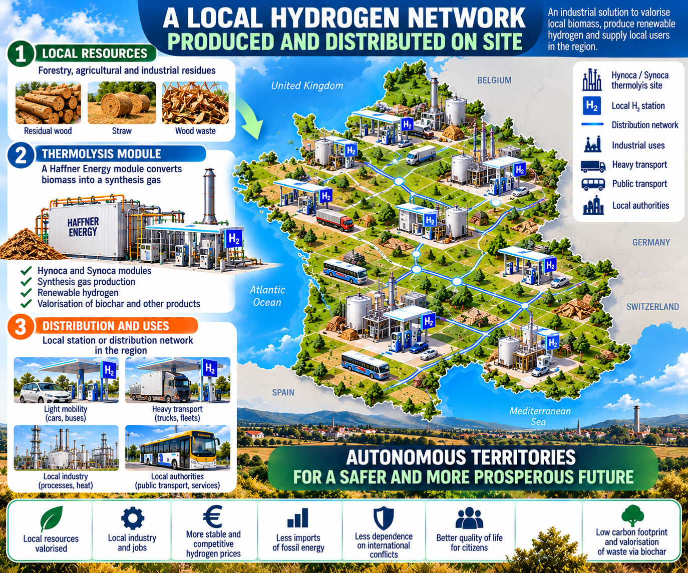
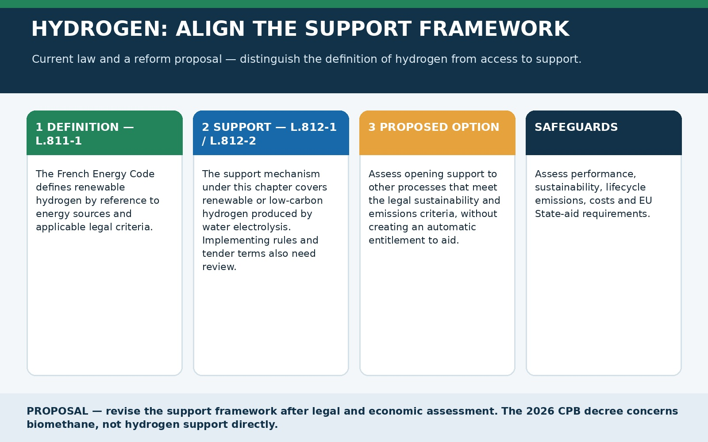
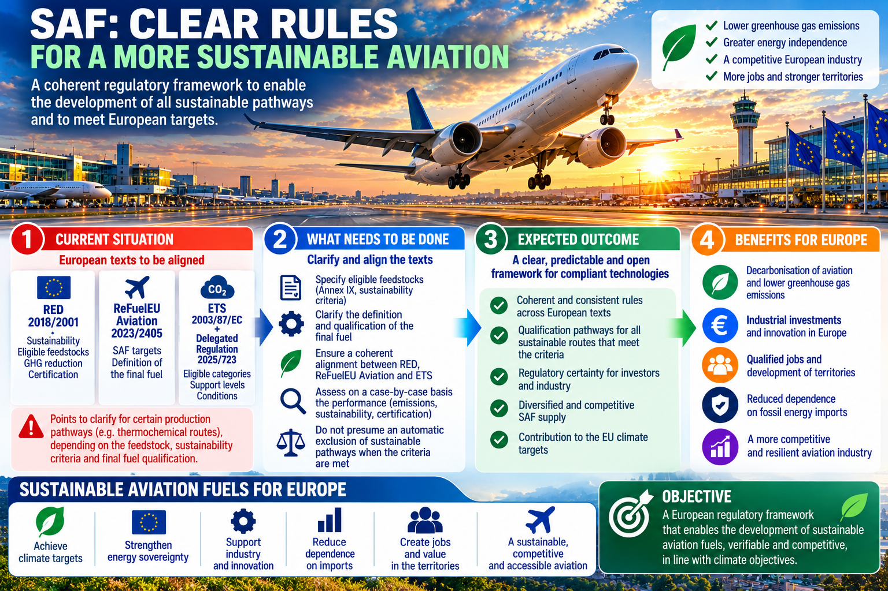
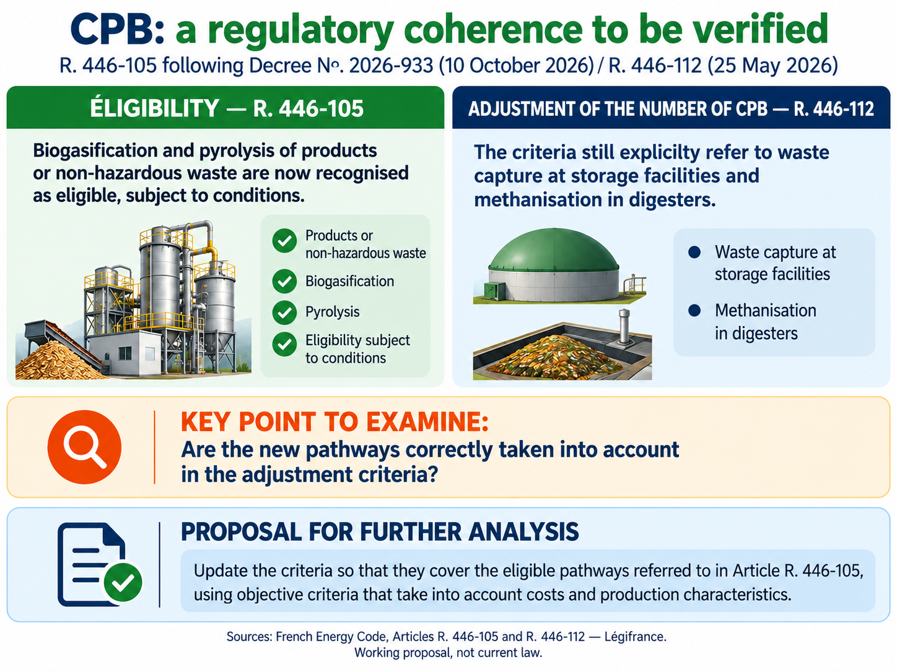
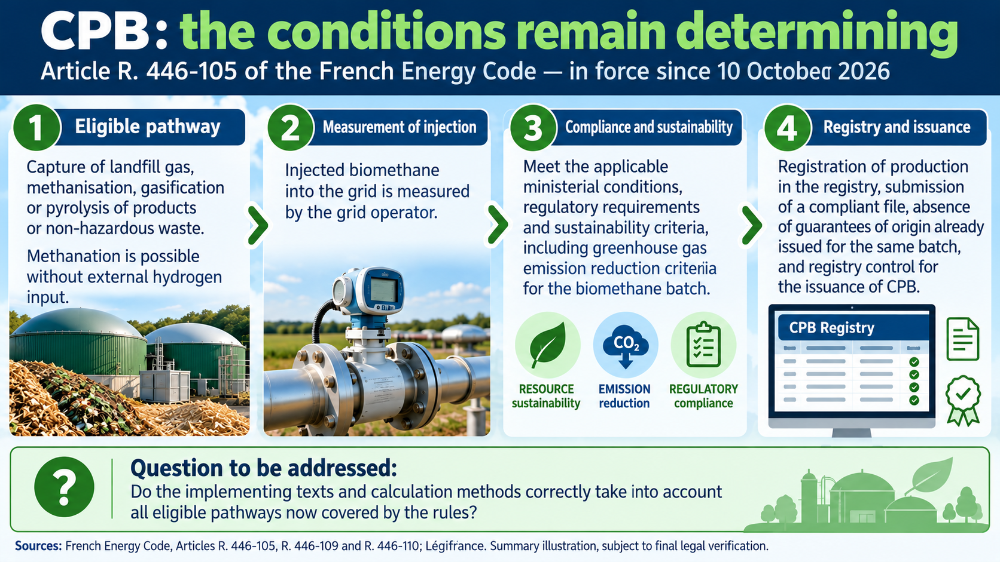
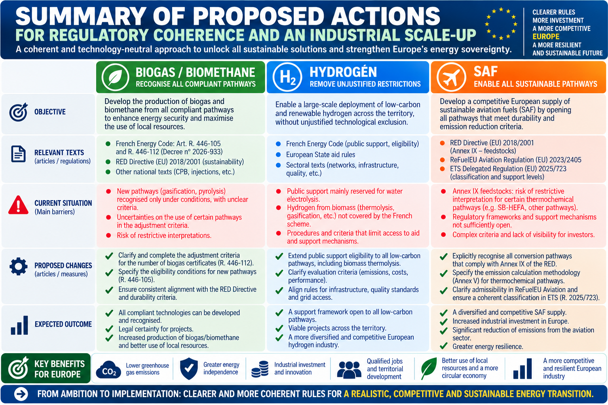

# Energy sovereignty: making the rules coherent so solutions can scale

*Eric Jacob — Working paper, English version — 20 October 2026*

> Europe does not only need more technologies. It also needs rules that allow them to demonstrate what they can deliver.

The energy transition is often presented as a race to invest: announce capacity, open funding windows, mobilise billions and set increasingly ambitious targets. All of that may be necessary. But a quieter question comes first: do the rules we have written actually allow solutions that could contribute to those targets to exist, develop and scale?

A technology may be promising without automatically qualifying for a support scheme, regulatory category or certification methodology. Conversely, a subsidy guarantees neither lasting competitiveness nor feedstock availability or customers. When regulation favours one pathway without comparing outcomes, and additional aid is then layered on to compensate for that pathway's difficulties, public policy risks financing symptoms rather than examining the cause.

This paper starts from a simple principle: **targets should be demanding, criteria transparent, and technology pathways open when they can meet those same criteria**. Technology neutrality does not mean every solution is equally good. It means that differences in treatment should rest on explicit, verifiable grounds: lifecycle emissions, feedstock sustainability, efficiency, full cost, resource availability, safety and real market demand.

Three areas illustrate the issue from different angles: renewable hydrogen, sustainable aviation fuels (SAF), and biomethane. They do not operate under the same rules or serve the same markets. Applying one identical regime to all three would be a mistake. Yet they share a need to prevent stated objectives, legal definitions, implementing measures and support schemes from contradicting one another or leaving gaps.

## 1. The underlying problem: energy policy is more than subsidies

Public funding can help an industry cross a threshold: support research, reduce the risk of a first industrial plant, build shared infrastructure or address an externality that markets do not price. But funding cannot indefinitely replace a viable business model, nor can it repair a poorly aligned regulatory architecture by itself.

When a technology cannot fit an eligibility category, demonstrate its performance under recognised rules or use a suitable emissions methodology, the debate too easily shifts to the size of the subsidy. The first question should instead be legal and methodological: **does the framework allow solutions to be compared against the outcomes that public policy claims to pursue?**

| Situation | Reasonable conclusion | What should follow |
|---|---|---|
| A statute expressly reserves a scheme to one technology. | There is a restriction within that scheme, not necessarily a general ban. | Examine the rationale and whether the scheme could open under common criteria. |
| The law recognises a pathway, but an implementing measure appears narrower. | An alignment or implementation issue may exist. | Compare the texts, their hierarchy and actual application. |
| Two provisions use different wording. | The difference warrants review, but does not itself prove exclusion. | Check context, cross-references and administrative practice. |
| A pathway is eligible but remains expensive or resource-constrained. | The problem may not be regulatory. | Examine costs, yields, feedstocks, infrastructure and customers. |

The proposal is not to demand an automatic right to subsidy. It is to let each solution demonstrate its value within a clear, auditable and coherent framework. A technology that fails climate or sustainability criteria should fail the assessment. A technology that meets them should not be ruled out solely because it follows a different route, unless there is an explicit and defensible reason.

## 2. Renewable hydrogen: when the definition and support scheme do not cover the same ground

Hydrogen is not an end in itself. Its value depends on the use, the resource, the energy consumed, lifecycle emissions and whether it can be produced at the right place and cost. Electrolysis can make sense where renewable electricity is available on suitable terms. Other thermochemical pathways, including those using sustainable biomass, also deserve rigorous assessment when legal requirements are met.

The French Energy Code distinguishes the definition of renewable hydrogen from the support mechanisms for its production. Article L. 811-1 is not framed solely around electrolysis. By contrast, Articles L. 812-1 and L. 812-2, within the mechanism they establish, target renewable or low-carbon hydrogen produced by water electrolysis. This is a limitation within a particular support mechanism, not a general ban on hydrogen produced by other routes and not proof that every form of public support is unavailable.

### What needs to be checked

The analysis must follow the chain from statute to the rules that determine access in practice: decrees, regulatory provisions, eligibility criteria, calculation methods, calls for projects, tender specifications and contracts. Articles R. 812-2, R. 812-14, R. 812-18, R. 812-19 and R. 812-26, together with Decree No. 2023-854 of 1 September 2023, should be examined in the versions applicable to the scheme. Each provision's actual role must be verified before it is described as expressly excluding a technology.

The proposal is not to replace one technological monopoly with another. It is to assess whether the support scheme can evaluate several production pathways against common criteria while preserving sustainability, traceability and emissions requirements. Biomass must not be presumed sustainable by definition: origin, competing uses, lifecycle performance and compliance with European rules must be demonstrated.

| Question | Current assessment | Possible next step |
|---|---|---|
| Do the legal definition and support eligibility have the same scope? | No: Articles L. 811-1 and L. 812-1/L. 812-2 must be read separately. | Assess explicit alignment without creating automatic entitlement to aid. |
| Do all regulatory provisions exclude non-electrolytic routes? | This must be established provision by provision. | Audit regulations, calls for projects and applicable specifications. |
| Can a thermochemical route qualify under EU law? | Not automatically. Sustainability, emissions, product definitions and State aid rules may matter. | Prepare a documented assessment and obtain any necessary approvals. |

### Reform proposal for assessment

Review Articles L. 812-1 and L. 812-2 to determine whether the scheme could cover different renewable or low-carbon hydrogen production pathways that meet legal requirements, rather than reserving it to one technology as a matter of principle. Any amendment should preserve emissions thresholds, sustainability safeguards, traceability and performance monitoring. Regulatory provisions and tender specifications should then be adapted only where the audit identifies a real restriction or inconsistency.

This would not mean that thermolysis automatically qualifies for funding, or that it will be more competitive everywhere. It would mean that the decision follows a comparable assessment rather than an inability to compete solely because of the production route.

**Official sources**

- [French Energy Code — Article L. 811-1](https://www.legifrance.gouv.fr/codes/article_lc/LEGIARTI000049463903/2026-02-22)
- [French Energy Code — Article L. 812-1](https://www.legifrance.gouv.fr/codes/article_lc/LEGIARTI000043154077/2026-07-13)
- [French Energy Code — Article L. 812-2](https://www.legifrance.gouv.fr/codes/article_lc/LEGIARTI000043154079/2026-10-09)
- [French Energy Code — relevant regulatory chapter](https://www.legifrance.gouv.fr/codes/id/LEGISCTA000048040122)
- [Decree No. 2023-854 of 1 September 2023](https://www.legifrance.gouv.fr/jorf/id/JORFTEXT000048039013)
- [LinkedIn: Hydrogen, scale-up and decentralisation](https://fr.linkedin.com/posts/eric-jacob-299a21344_hydrog%C3%A8ne-haffnerenergy-thermolyse-activity-7516468302353895424-4Ypq)

## 3. SAF: European targets should leave room for sustainable pathways that can meet them

Aviation cannot replace liquid fuels with electricity overnight. Sustainable aviation fuels will therefore play an important role, but SAF covers different production pathways, feedstocks and certification requirements. An intermediate oil produced from biomass is not automatically an eligible sustainable aviation fuel: the conversion route, final fuel properties, certification, sustainability criteria and emissions profile all need to be checked.

The SB-HEFA pathway presented by Haffner Energy uses thermolysis of solid residual biomass to produce a liquid intermediate for fuel upgrading. Its potential interest includes the ability to use solid residues rather than relying exclusively on certain oils or fats. That does not remove the need to demonstrate product quality, actual feedstock availability, environmental performance and compliance with EU rules. The process, intermediate product and final aviation fuel must be distinguished carefully.

### Three sets of rules, three different questions

The Renewable Energy Directive (RED) sets rules on feedstock categories, sustainability, emissions savings and certification. The ReFuelEU Aviation Regulation establishes obligations for sustainable aviation fuels and refers to relevant EU sustainability criteria. The EU Emissions Trading System (ETS) and Delegated Regulation (EU) 2025/723 establish specific support arrangements for certain eligible fuel categories.

These instruments do not serve exactly the same purpose. It would be unsafe to conclude that a pathway is excluded from SAF eligibility or all support simply because categories differ. The precise feedstock category, recognised conversion pathway, certification requirements and support category for the eligible final fuel must be established.

| Instrument | Function | What must be checked for SB-HEFA |
|---|---|---|
| Renewable Energy Directive (EU) 2018/2001, including Annexes IX and V and Article 30 | Feedstock categories, sustainability, emissions calculations and certification. | Confirm the precise feedstock category, applicable methodology and certification evidence. |
| Regulation (EU) 2023/2405, ReFuelEU Aviation | Aviation fuel obligations and eligibility. | Confirm that the production route and final fuel meet regulatory and technical requirements. |
| Directive 2003/87/EC and Delegated Regulation (EU) 2025/723 | ETS-linked support for certain eligible fuel categories. | Establish the applicable classification; do not assume SB-HEFA is excluded or automatically receives the most favourable rate. |
| Fuel certification and technical standards | Quality, traceability and safe aviation use. | Confirm qualification stages and compliance of the final fuel. |

### Technology neutrality is not the absence of standards

Biomass is a limited resource competing across uses: heat, materials, gas, hydrogen, liquid fuels and the preservation of soil and forest ecosystems. A coherent policy should avoid double-counting resources, account for alternative uses and favour pathways that deliver the best outcomes in a given context.

But these requirements do not justify closing a pathway before establishing how it should be assessed. If a feedstock or conversion category is unclear, if a methodology cannot adequately represent a verifiable lifecycle outcome, or if a support scheme classifies fuels without considering an emerging route, the answer should be a documented clarification—not presumed eligibility and not automatic exclusion.

### Proposed work

Launch a joint RED–ReFuelEU–ETS review focused on SAF pathways using solid residual biomass. It should publish a mapping matrix connecting feedstocks, processes, final fuels, sustainability criteria, emissions methodologies, certification and support mechanisms. Where the rules do not clearly cover a pathway, the relevant provision or assessment procedure should be clarified while preserving climate objectives and aviation safety requirements.

The aim is not to create an exception for SB-HEFA. It is to make the framework clear enough for any pathway to be assessed on its merits, without preferential treatment and without being disadvantaged by an ambiguity that has never been examined.

**Official sources**

- [Directive (EU) 2018/2001 — Renewable Energy Directive](https://eur-lex.europa.eu/eli/dir/2018/2001/oj)
- [Regulation (EU) 2023/2405 — ReFuelEU Aviation](https://eur-lex.europa.eu/eli/reg/2023/2405/oj)
- [Delegated Regulation (EU) 2025/723](https://eur-lex.europa.eu/eli/reg_del/2025/723/oj)
- [European Commission — ReFuelEU Aviation FAQ](https://transport.ec.europa.eu/transport-modes/air/environment/refueleu-aviation/faq-refueleu-aviation_en)
- [LinkedIn: proposed regulatory clarifications for SAF](https://fr.linkedin.com/posts/eric-jacob-299a21344_saf-refueleu-red-activity-7517583692655902720-ViIK)
- [LinkedIn: SAF and hydrogen — should Europe open every viable pathway?](https://fr.linkedin.com/posts/eric-jacob-299a21344_haffnerenergy-saf-sbhefa-activity-7508870054000766977-aZ56)
- [LinkedIn: Taxing kerosene to fund SAF, provided the SAF is competitive](https://fr.linkedin.com/posts/eric-jacob-299a21344_saf-sbhefa-haffnerenergy-activity-7511415430515707904-7-8Y)

## 4. Biogas and biomethane: a meaningful opening whose implementing rules must keep pace

French Decree No. 2026-933 of 30 September 2026, published in the Official Journal on 9 October, marks an important change to the biogas production certificate (CPB) scheme. It extends the scheme to 2044 and, subject to conditions, opens it to certain gasification and pyrolysis pathways. This matters: it recognises that renewable gas production is not limited to one family of processes.

Yet a reform does not end with the provision that recognises a new route. The rules on issuance, calculation, modulation and verification must also be checked. Articles R. 446-105 and R. 446-112 deserve to be read together. The former recognises new routes within the scheme; the latter explicitly mentions certain established routes in its modulation criteria. This difference in wording warrants review. On its own, however, it does not establish that new pathways are excluded or cannot be taken into account.

### What the audit must establish

The review should determine whether implementing provisions account for newly recognised processes, how certificates are calculated, what data operators must provide, which feedstock requirements apply and how modulation affects different installations. It should also examine the exact meaning of the terms used, cross-references and any implementing orders.

| Question | Why it matters | Cautious assessment at this stage |
|---|---|---|
| Does the decree recognise new pathways? | Recognition opens a legal route subject to conditions. | Yes, certain gasification and pyrolysis pathways are introduced subject to conditions. |
| Are modulation provisions fully aligned with that opening? | Rules designed around established routes may require clarification. | This must be checked against all applicable provisions and actual implementation. |
| Does the wording difference prove exclusion? | Legal interpretation cannot rest on one phrase in isolation. | No, not by itself. |
| What should be proposed? | Calculation and control rules must be understandable and applicable. | Audit the rules, then amend only provisions shown to be inadequate. |

### Proposed work

Publish interpretive guidance or, if the audit supports it, amend relevant regulatory provisions and implementing orders to clarify how newly recognised routes are reflected in CPB issuance and modulation rules. The clarification should preserve sustainability checks, gas quality, traceability and pathway-specific conditions. It should not automatically assign identical economic effects to processes that do not deliver the same service.

This approach is stronger than alleging an unproven exclusion. It builds on a real regulatory development and asks the natural question that follows every reform: have the implementing rules been updated so the opening can deliver its intended effect?

**Official sources**

- [Decree No. 2026-933 of 30 September 2026](https://www.legifrance.gouv.fr/jorf/id/JORFTEXT000054965211)
- [French Energy Regulatory Commission — deliberation No. 2026-130](https://www.cre.fr/documents/deliberations/projet-de-decret-relatif-a-lobligation-de-restitution-de-certificats-de-production-de-biogaz.html)
- [French Senate — question on pyrogasification](https://www.senat.fr/questions/base/2026/qSEQ260408518.html)
- [French Senate — question on CPBs and pyrogasification](https://www.senat.fr/questions/base/2026/qSEQ260207627.html)
- [LinkedIn: CPB decree and regulatory clarification](https://fr.linkedin.com/posts/eric-jacob-299a21344_biom%C3%A9thane-gazrenouvelable-souverainet%C3%A9%C3%A9nerg%C3%A9tique-activity-7515723539149135872-dmSa)

## 5. The common thread: coherent rules can sometimes do more than another scheme

These three files do not call for the same amendment. Hydrogen raises questions about the scope of a support mechanism. SAF requires a cross-reading of feedstock categories, conversion routes, certification and European support. Biomethane raises the question of implementing rules after a scheme has been opened to new pathways. Bringing them together does not mean pretending they share one identical legal flaw.

They do, however, reveal a common governance challenge. Rules are often drafted in stages to meet a specific need. Over time, definitions, exceptions, cross-references and support schemes accumulate. Each provision may be defensible in isolation while the overall framework becomes hard to understand for industry, investors and the authorities responsible for applying it.

The reflex is then to add another measure to correct the effects of the previous one: a funding window, a derogation, a new category, another support scheme. Yet a coherence review—less visible than a new funding announcement—can sometimes deliver more: predictable rules, fewer overlapping constraints, lower uncertainty and better-targeted public support.

This requires resisting two opposite temptations. Opening every route does not make every route viable: resources are limited, yields differ, infrastructure costs money and environmental requirements must remain binding. But selecting one technology in advance, building a bespoke regime around it and maintaining that choice through growing subsidies without reviewing results is not a durable industrial policy either.

A stronger approach defines the service required, sets measurable outcomes, demands evidence and compares solutions under the same conditions. Some technologies will fail that assessment. Others may work in certain places or uses but not everywhere. That is precisely what well-designed regulation should allow: selection based on results, not premature closure.

## 6. A practical method for making rules coherent

Reform should begin with a short, verifiable legal map—not with the immediate drafting of another layer of rules.

1. **Start with the official text in force.** Identify the version, effective date, transitional provisions and hierarchy between statutes, decrees, orders, decisions and tender specifications.
2. **Trace the regulatory chain.** For each production route, follow product definitions, sustainability criteria, calculation methods, certification, eligibility and monitoring.
3. **Classify the problem.** Distinguish explicit exclusion, wording differences, ambiguity, missing methodology and purely economic obstacles.
4. **Measure the consequences.** Compare full cost, lifecycle emissions, efficiency, feedstock availability, infrastructure requirements and real demand.
5. **Propose the smallest sufficient amendment.** Fix the provision that causes the problem rather than adding an entire scheme where a definition or shared method would suffice.
6. **Check EU compatibility.** Review sustainability rules, State aid, sectoral targets and certification obligations.
7. **Publish criteria and results.** Applicants should know what evidence to provide, and decisions should be explainable.

This method does not reduce law to a simplistic mechanism. It seeks to make each provision intelligible within the framework it belongs to. The best text is not necessarily the shortest one; it is the one whose objectives, conditions and consequences are coherent enough to be understood and applied without endless corrective measures.

## 7. What this proposal does not claim

A credible argument must be as clear about its limits as it is about its aims.

- It does not claim that every biomass pathway is sustainable.
- It does not claim that thermolysis automatically qualifies under every EU category, certificate or support scheme.
- It does not claim that electrolysis, anaerobic digestion or other pathways should be excluded.
- It does not claim that a wording difference alone proves legal exclusion.
- It does not claim that regulatory opening guarantees project profitability.
- It does not call for the general abolition of public support.

It asks that rules be assessed against their stated objectives and that technology choices be justified. Public support can be useful when it addresses a market failure, supports innovation or accelerates shared infrastructure. It becomes harder to justify when it is used indefinitely to compensate for a regulatory architecture that prevents solutions from being compared.

---

## Summary of Proposed Actions for Regulatory Alignment and Industrial Scale-Up

The proposals presented in this article share a common objective: **to enable technologies that comply with European objectives to reach industrial scale, based on their actual performance rather than unjustified technological restrictions.**

Three areas are concerned: gas and biomethane, hydrogen, and sustainable aviation fuels (SAF). For each, the aim is to identify provisions that need clarification or amendment, remove unjustified barriers, and ensure consistency between European legislation, implementing measures, and public support mechanisms.

### A shared ambition: turning objectives into results

The energy transition cannot achieve lasting industrial scale if it depends on permanent subsidies or excludes potentially competitive solutions. Public support can help emerging industries develop, but it cannot replace economic competitiveness, legal certainty, or the ability to deploy repeatable, commercially viable installations.

The priority is therefore to establish rules that are clear, consistent, and sufficiently open to ensure that solutions meeting sustainability, emissions-reduction, and performance requirements can be assessed fairly and developed where their results justify it.

This approach serves a broader ambition: making better use of local resources, strengthening European energy sovereignty, stimulating industrial investment and employment, and accelerating emissions reductions without creating lasting economic dependencies.

**This summary is a working proposal, not a definitive legislative text.** The suggested amendments must be examined by the competent authorities, assessed against the applicable legislation, and adjusted where necessary during the legislative and regulatory process. The aim is to provide a practical basis for discussion: identify the barriers, propose specific changes, and make industrial scale-up possible on the basis of objective criteria.

## Conclusion — Giving objectives the means to become reality

Europe has set ambitious energy and climate goals. Meeting them will require decarbonised electricity, efficiency, networks, sustainable fuels, renewable molecules, better use of resources and industries able to produce at acceptable cost. No single technology can do everything. Nor should a pathway be condemned without its performance being assessed against clear criteria.

Energy sovereignty is not about replacing one dependency with another, or confusing announced industrial capacity with actual use. It means bringing resources closer to demand, protecting natural resources, making investment predictable and building a regulatory framework that lets solutions prove their value.

The question is not whether there should be more or fewer rules in the abstract. It is whether we have the right rules, whether they fit together and whether they serve the outcome they were designed to achieve.

**Technology cannot do everything. But the law should not prevent a technology from contributing to an objective that the law itself has set.**

---

## Related publications and working papers

- [Hydrogen: the real route to scale should be decentralised](https://fr.linkedin.com/posts/eric-jacob-299a21344_hydrog%C3%A8ne-haffnerenergy-thermolyse-activity-7516468302353895424-4Ypq)
- [Why allow thermolysis for gas while maintaining barriers for biomass-based hydrogen and SAF?](https://fr.linkedin.com/posts/samuel-thiret_hydrog%C3%A8ne-biom%C3%A9thane-saf-activity-7514417736026857474-BXnl)
- [SAF and hydrogen: should Europe open every viable pathway?](https://fr.linkedin.com/posts/eric-jacob-299a21344_haffnerenergy-saf-sbhefa-activity-7508870054000766977-aZ56)
- [Taxing kerosene to fund SAF, provided the SAF is competitive](https://fr.linkedin.com/posts/eric-jacob-299a21344_saf-sbhefa-haffnerenergy-activity-7511415430515707904-7-8Y)
- [Biomethane: the CPB decree opens new routes; are the associated rules fit for purpose?](https://fr.linkedin.com/posts/eric-jacob-299a21344_biom%C3%A9thane-gazrenouvelable-souverainet%C3%A9%C3%A9nerg%C3%A9tique-activity-7515723539149135872-dmSa)
- [Energy sovereignty: we are still backing the wrong solutions](https://fr.linkedin.com/posts/eric-jacob-299a21344_souverainet%C3%A9%C3%A9nerg%C3%A9tique-hydrog%C3%A8ne-biomasse-activity-7503518212366479360-TNc6)

*This paper is an analytical working document and set of proposals. Proposed amendments must be checked against consolidated legislation, all implementing provisions and, where appropriate, specialist legal advice before formal legislative or regulatory action.*
